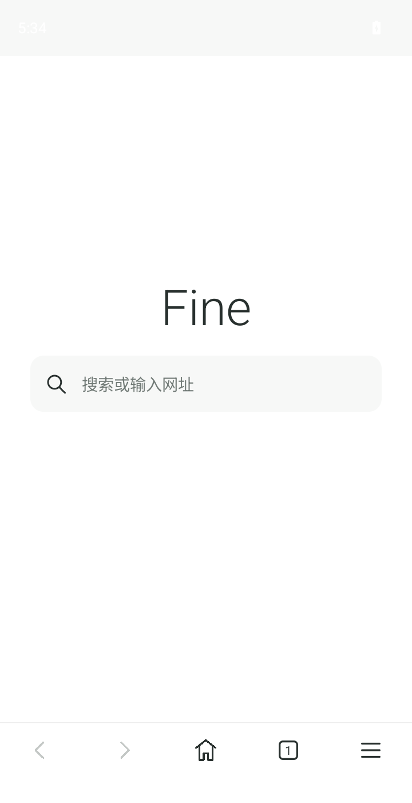
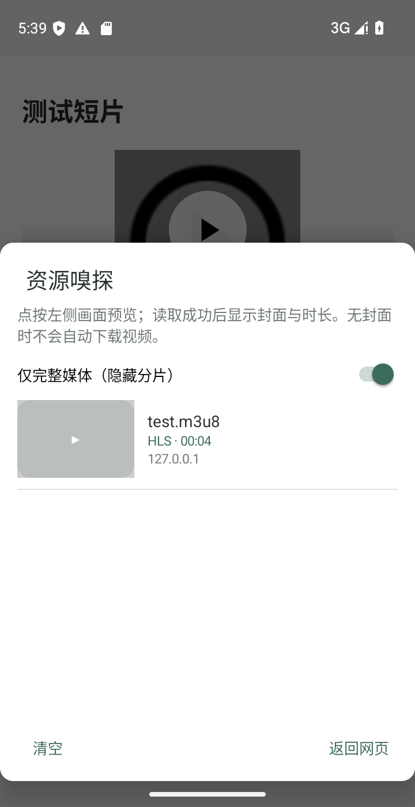
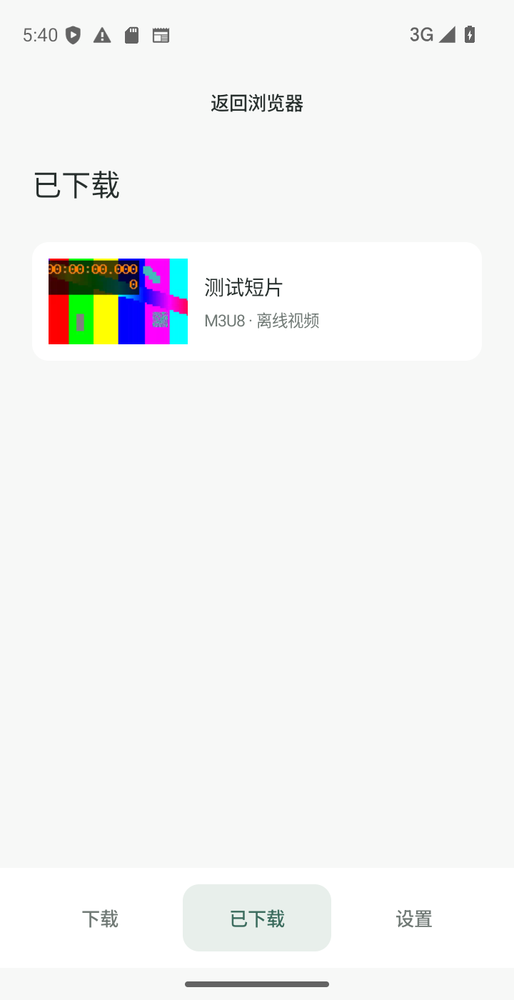

# Fine

一款能找到网页视频的 Android 浏览器。打开网页，点一下「媒体」就能预览视频，也能把点播视频下载到手机上离线观看。

**Android 6.0+** · **源码 v1.6.3** · [MIT 许可证](LICENSE)

## 安装

- **直接安装 v1.5.0**　用 Android 手机[下载 APK](https://github.com/AzumiYumei/Fine/releases/download/v1.5.0/Fine-v1.5.0.apk)，打开文件并按系统提示安装。这个版本可粘贴 M3U8 链接播放、下载和转 MP4。
- **使用 v1.6.3 浏览器**　按下方[源码构建](#源码构建)安装。以下截图及网页嗅探、历史记录操作对应这个版本。

## 从网页保存第一个视频

| ① 打开视频网页 | ② 找到视频 | ③ 离线观看 |
| :--- | :--- | :--- |
|  |  |  |
| 点「搜索或输入网址」，进入网页并播放视频。 | 点地址栏旁的「媒体」。点左侧画面可预览，点 HLS 条目再选「下载 M3U8」。 | 打开「已下载」，点封面播放。长按视频可选「转为 MP4」。 |

**已有 M3U8 链接？** 在「菜单 → 下载」粘贴完整链接，点「播放」或「下载」。带签名的链接请保留问号后的参数。

## 常用功能

| 想做什么 | 在哪里操作 |
| --- | --- |
| 边看边找视频 | 最多打开 8 个标签页，各自保留嗅探结果。「菜单 → 资源嗅探」可查看或复制链接。 |
| 暂停下载、更改保存位置 | 在「下载」暂停或继续任务。在「设置 → 下载位置」选择文件夹，对新任务生效。 |
| 找回看过的网页 | 在「菜单 → 历史记录」按标题或网址搜索。这里也能清空记录、关闭记录。 |
| 管理网站数据 | 「菜单 → 隐私保护」可限制第三方 Cookie、禁用 JavaScript 或清除网站数据。 |

## 适配情况

| 项目 | 支持范围 |
| --- | --- |
| 系统 | 最低 Android 6.0（API 23），目标 Android 14（API 34）。网页由系统 WebView 打开。 |
| 视频 | HLS（M3U8）点播可播放、下载；直播仅在线播放。普通音视频能否预览取决于设备解码器。 |
| 转 MP4 | 支持普通及 AES-128 HLS，使用设备能力封装音视频，无需重新编码。默认保留源文件。 |
| 网站限制 | 播放器和下载器不继承网页登录状态。需要 Cookie、自定义 Referer 或 DRM 授权的视频可能无法播放或下载。 |

v1.6.3 已在 23117RK66C 真机安装并启动，36 项单元及 Robolectric 测试通过。[查看分版本测试记录](docs/testing.md)

## 源码构建

用 Android Studio 打开仓库，选择 JDK 17，安装 Android SDK 34 和 Build Tools 34.0.0。连接手机，点击 **Run ▶** 即可安装当前源码版。

<details>
<summary>用命令行生成 APK</summary>

在仓库根目录运行（macOS / Linux 使用 `./gradlew` 替换 `.\gradlew.bat`）。

```powershell
.\gradlew.bat :app:assemblePreview
```

体验包位于 `app/build/outputs/apk/preview/app-preview.apk`，使用本机调试证书签名。运行 `.\build.ps1` 还会执行单元测试和 Lint。

</details>

## 许可证与签名证书

Fine 源码采用 [MIT License](LICENSE)。发布页提供 [v1.5.0 安装包及 SHA256SUMS.txt](https://github.com/AzumiYumei/Fine/releases/tag/v1.5.0)，可核对下载文件。

<details>
<summary>核对 v1.5.0 APK 的签名证书</summary>

该体验包使用 Android Debug 签名。[下载此 APK 的公开证书（PEM）](docs/v1.5.0-signing-cert.pem)

使用 Android SDK Build Tools 的 `apksigner` 检查下载的 APK：

```sh
apksigner verify --print-certs Fine-v1.5.0.apk
```

输出中的 `certificate SHA-256 digest` 应为 `4b4b073a268600baf9baf9006a698bf272893ad88b9eefd429ac75f4e66d53d3`。

</details>
